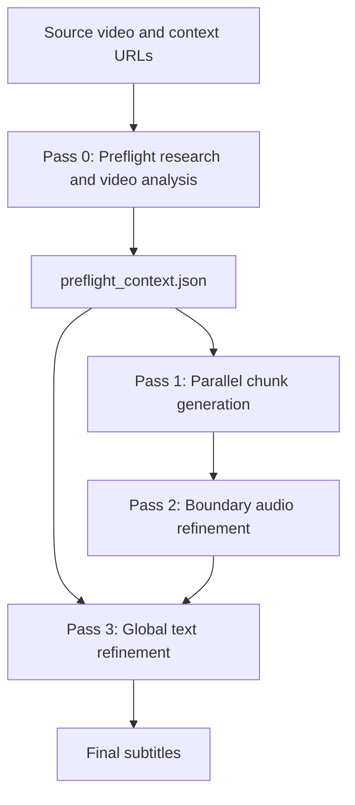
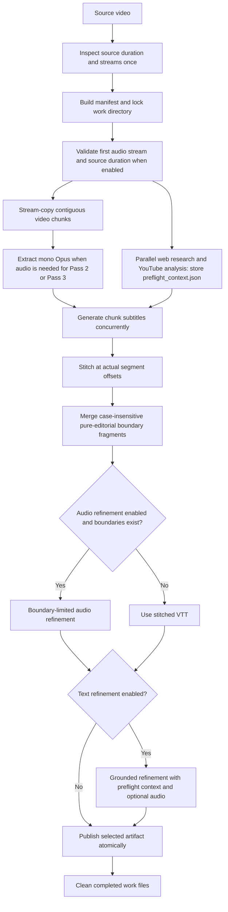

# Video subtitler

This context defines the architecture, data schemas, algorithms, prompt contracts, and operational rules required to recreate the video subtitler pipeline from first principles.

## Purpose

This project is a Python command-line tool that creates English WebVTT subtitles from video.
It uses an audio-first pipeline with four Gemini passes:
1. A preflight pass researches participant identities and topic terminology before chunk generation.
2. Stream-copy video chunks are subtitled concurrently with Gemini 4 Hydrogen.
3. A boundary-limited audio pass listens to the complete extracted audio and repairs faults near chunk boundaries.
4. A grounded refinement pass improves the complete subtitle script with the preflight research context and optional complete audio.

The design targets accurate speech timing, faithful translation, and useful on-screen text.
It favors throughput and resumability.
FFmpeg performs local media work.
The Gemini API performs video interpretation, audio repair, and translation.
Pydantic validates every structured model response before it reaches the output file.

## System model

The pipeline runs four passes over one work directory:



The normal generation path runs these stages:



The command holds one process lock for the complete work-directory lifecycle.
The lock covers splitting, audio extraction, API calls, output publication, and success cleanup.
All preflight workers settle before the lock is released, including on failure.

## Repository layout

Every tracked file in this repository has a defined responsibility.

| Path | Responsibility |
| --- | --- |
| `gemini_subs.py` | CLI entry point: dotenv loading, argument parsing, validation, and dispatch. |
| `modules/core.py` | Core schemas, timestamp handling, source titles, context URL policy, caption validation, cue classification, speaker label casing canonicalization, sparse audio-patch filtering, reconstruction, and validation, and pure-editorial boundary merging. |
| `modules/io.py` | Atomic JSON and VTT publication, manifest file I/O, and work-directory logging. |
| `modules/media.py` | FFmpeg and FFprobe operations for probing, complete audio extraction, and stream-copy splitting. |
| `modules/gemini.py` | Gemini clients, prompts, request configs, chunk requests, preflight research, boundary audio refinement, and global text refinement. |
| `modules/pipeline.py` | Generation configuration, locking, scheduling, stitching, and the run lifecycle. |
| `scripts/benchmark.py` | Full-video matrix benchmark across generation, audio refinement, and text refinement models. |
| `scripts/subtitle.sh` | Wrapper script that runs generation with terminal context URL prompting. |
| `scripts/yt-dl.sh` | YouTube downloader that fetches VP9/WebM video via `yt-dlp`. |
| `scripts/ffmpeg.sh` | Headless GPL static FFmpeg and FFprobe installer for Linux hosts. |
| `tests/` | End-to-end pipeline and capability contract test suite. |
| `AGENTS.md` | Authoritative behavioral and development instructions for agents. |
| `CONTEXT.md` | Complete architectural specification and domain glossary. |
| `README.md` | User-facing installation, usage, and development guide. |
| `pyproject.toml` | Python project metadata, tool configuration, and dependency declarations. |
| `uv.lock` | Exact dependency lockfile managed by `uv`. |
| `.env.example` | Environment variable template for credentials and model defaults. |
| `.gitignore` | Ignores credentials, caches, generated media, work directories, and subtitle outputs. |
| `.python-version` | Pins the Python interpreter version for `uv`. |

Keep the five modules in `modules/` on an acyclic dependency graph:
- `modules/core.py` and `modules/io.py` are foundations with no project-internal imports.
- `modules/media.py` depends only on `io`.
- `modules/gemini.py` depends on `core`, `io`, and `media` (for `AUDIO_MIME_TYPE`).
- `modules/pipeline.py` orchestrates media and Gemini and owns the run lifecycle.
- `gemini_subs.py` stays CLI-only: dotenv loading, argument parsing, validation, and dispatch.

## Runtime requirements

The project requires Python 3.14 or newer.
Use `uv` for dependency installation and tool execution.

Runtime dependencies:
- `google-genai>=3.3.0` for Gemini API access.
- `pydantic>=2.14.0` for response schemas and validation.
- `python-dotenv>=1.2.2` for `.env` loading.
- `webvtt-py>=0.8.0` for strict VTT reading and writing.

The CLI requires `ffmpeg` and `ffprobe` in `PATH`.
Install headless GPL static binaries via `./scripts/ffmpeg.sh`.

## Configuration

`python-dotenv` loads `.env` when `gemini_subs.py` starts.
The shell environment and CLI arguments can also provide these values.
CLI arguments take precedence over environment variables.
An empty `GEMINI_MODEL` uses the default chunk model.
An empty `GEMINI_AUDIO_REFINE_MODEL` uses the default audio refinement model.
An empty `GEMINI_REFINE_MODEL` uses the default text refinement model.
Both CLI modes reject an output path whose parent is missing or is not a directory before media or API work.
CLI errors go to standard error.

| Variable | CLI option | Default | Use |
| --- | --- | --- | --- |
| `GEMINI_API_KEY` | `--api-key` | None | Required Gemini credential. |
| `GEMINI_API_BASE` | `--base-url` | SDK default | Optional Gemini-compatible proxy base URL. |
| `GEMINI_MODEL` | `--model` | `gemini-4-hydrogen` | Chunk video model. |
| `GEMINI_AUDIO_REFINE_MODEL` | `--audio-refine-model` | `gemini-4-hydrogen` | Boundary audio refinement model. |
| `GEMINI_REFINE_MODEL` | `--refine-model` | `gemini-4-hydrogen` | Full-script refinement model. |

For programmatic generation, an omitted `GenerationConfig.audio_refine_model` or `GenerationConfig.refine_model` uses `config.model`.
The CLI supplies the separate refinement defaults shown above, except `--refine-only` falls back to `--model` when `--refine-model` and `GEMINI_REFINE_MODEL` are omitted.

The chunk thinking level accepts `low`, `medium`, `high`, and `xhigh`.
It defaults to `high`.
The `xhigh` level applies to `gemini-4-hydrogen` and is not supported on `gemini-4-carbon` or `gemini-4-argon`.
The text refinement pass always uses `high`.
The audio refinement pass always uses `high`.
All five Gemini request types select a model-aware output-token limit through `_build_content_config()`.
Gemini 4 models (`gemini-4*`) use `GEMINI_4_MAX_OUTPUT_TOKENS = 1_048_576`.
Other models use `MAX_OUTPUT_TOKENS = 65536`.
These limits apply to chunk generation, Pass 0 web research and YouTube analysis, audio refinement, and text refinement.
Every request configured with a thinking level sets `include_thoughts=True`.
Thought tokens stream in real time across the transport boundary.
These tokens keep the HTTP streaming connection active.
Host stream consumers accumulate candidate answer text only.
The host excludes thought-only stream chunks (`text=None`) from assembled JSON and research text outputs.

Direct CLI defaults:
- `--chunk-dur 60` seconds.
- `--workers 7` API workers.
- `--output output_subtitles.vtt`.
- Audio refinement enabled.
- Text refinement enabled.
- No `--context-url` values.

`--disable-audio-refine` disables boundary audio repair and makes Pass 3 text-only.
`--disable-text-refine` disables global text refinement.
`--refine-only` runs text-only global refinement directly on an input VTT file.

## Artifact publication matrix

Generation publishes one artifact based on the refinement toggles:

| Audio refinement | Text refinement | Published input |
| --- | --- | --- |
| Enabled (default) | Enabled (default) | Text-refined `audio_refined.vtt` |
| Enabled | Disabled (`--disable-text-refine`) | `audio_refined.vtt` |
| Disabled (`--disable-audio-refine`) | Enabled | Text-refined `stitched.vtt` |
| Disabled (`--disable-audio-refine`) | Disabled (`--disable-text-refine`) | `stitched.vtt` |

Single-chunk runs skip Pass 2 because they have no repair boundaries.
They pass stitched subtitles to Pass 3 with complete audio when audio refinement is enabled.
Without Pass 3, they publish stitched subtitles directly.

## Video support

`inspect_media()` asks FFprobe for the container duration and stream metadata in one query:

```bash
ffprobe -v error -show_entries format=duration:stream=codec_type,codec_name,sample_rate,channels -of json <path>
```

Supported codecs:

| Primary codec | Chunk extension | MIME type |
| --- | --- | --- |
| VP9 | `.webm` | `video/webm` |
| H.264 | `.mp4` | `video/mp4` |
| HEVC/H.265 | `.mp4` | `video/mp4` |

Unsupported codecs like AV1 fail with `RuntimeError`.
The primary video codec is the first video stream's codec.
The pipeline and benchmark runner reuse the inspection for format selection, audio presence, source duration, and complete audio extraction.
Audio is mapped with `-map 0:a?` when present.
Subtitle streams are excluded from generated chunks with `-sn`.

## Complete audio extraction

Audio refinement always selects the first audio stream, `0:a:0`.
When audio refinement is enabled, the pipeline validates the inspected audio streams and duration while holding the work lock.
The run fails before splitting or API calls when the source has no audio stream.
It also rejects an invalid source duration before API calls.
After splitting, the pipeline extracts audio when audio refinement is enabled and either repair boundaries exist or Pass 3 is enabled.
A single-chunk run skips Pass 2, but still extracts audio for enabled Pass 3.
When both repair boundaries and Pass 3 are absent, it publishes stitched subtitles without extracting audio.
Passes 2 and 3 send audio inline with MIME type `audio/ogg`; they never upload files.
Each request warns when inline audio exceeds 50 MiB and still sends the audio.

Extraction command:

```bash
ffmpeg -y -i <video_file> -map 0:a:0 -vn -sn -c:a libopus -b:a 32k -ac 1 -ar 48000 -f ogg extracted_audio.ogg.tmp
```

The temporary file is published atomically with `os.replace()`.
A cached `extracted_audio.ogg` is reused only when FFprobe reports one mono Opus stream at 48 kHz, a positive finite duration, and a duration within 2.0 seconds of the source media duration.
Corrupt or inconsistent audio is regenerated.
Extraction returns both audio and source-video durations to the pipeline and benchmark runner.
The audio refinement validator uses both durations without probing the media again.

## Chunking and segmentation

Stream-copy splitting runs:

```bash
ffmpeg -y -i <video_file> -map 0:v:0 -map 0:a? -sn -c copy \
  -f segment -segment_time <chunk_dur> \
  -segment_list segments.csv -reset_timestamps 1 \
  chunk_%03d<ext>
```

Stream copy cuts at keyframes.
`segments.csv` is the source of truth for chunk start and end times.
Each nonblank row has exactly three fields: `chunk_NNN.<ext>,start,end`.
Chunk filenames must follow index order starting at `chunk_000`.
The host regenerates the split if it cannot read the index as UTF-8 or if any nonblank row is malformed or has invalid timestamps.
Blank rows do not consume chunk indices, and chunk starts must increase strictly.
A reusable index must match stored `chunk_NNN` files exactly.

### Chunk generation context

Each chunk prompt carries optional context blocks before the timing rules.
`SOURCE CONTEXT` holds the derived source title with candidate-identity warnings.
`CANDIDATE SPEAKER IDENTITIES` holds only the bare preflight grounded names as a candidate roster, without appended role details.
The roster permits a candidate's canonical English name only when direct in-clip evidence, such as a visible name banner, lower-third, title card, or spoken introduction, establishes attribution in the clip.
It never assigns identities from appearance alone.
When candidate-name attribution is uncertain, generation prefers a specific, stable role that reflects the speaker's function in the scene.
Examples include `Coach:`, `Chef:`, `Judge:`, `Prosecutor:`, `Referee:`, `Interviewer:`, `Father:`, `Daughter:`, `Shop Owner:`, and `Producer:`.
When an individual speaker's role is clear, generation prefers a concrete single-person role over vague umbrella labels such as `Cast Member:`, `Participant:`, and `Person:`.
Generation reserves `Host:` for an actual program host or studio MC, not an instructor, specialist, or activity leader.
It keeps one consistent name or role prefix for each attributed speaker throughout the entire clip.
It does not switch the same speaker between role labels such as `Referee:` and `Host:`.
When speakers address each other by role, generation keeps consistent role or kinship prefixes across turns instead of reverting to unlabeled dialogue.
It repeats the speaker's prefix on each consecutive cue in that speaker's turn.
It leaves dialogue unlabeled only when neither a candidate name nor a clear descriptive role can be distinguished.
When simultaneous speech and meaningful editorial text cannot be sequenced without loss, generation permits a two-line mixed cue with bracketed editorial text followed by dialogue.
Generation intentionally keeps bracketed variety captions, echo captions, punctuation graphics such as `[?????]`, and bracketed ellipsis or silence graphics such as `[...]` when they appear on screen, rather than filtering them out to lower reading speed.
Generation never uses `[...]` as a placeholder for spoken dialogue.
In mixed cues, these graphics stay on the editorial line, separate from the dialogue line.

### Chunk generation retry

HTTP transport errors, 429 rate limits, and 5xx server errors are handled natively by the Gemini SDK.
Every client sets `http_options.retry_options` to `types.HttpRetryOptions()`, so the SDK makes up to 5 attempts with exponential backoff and jitter.
Requests retain the SDK default `automatic_continuation=True`.
When a response ends with `CONTINUATION`, the SDK sends the same request with its continuation token until generation finishes and exposes the continued stream to the host.
Timeouts, SDK retries, and billing apply separately to each continuation hop, not once to the full logical request.
Each hop preserves the request's `max_output_tokens`.
On Gemini 4, values above 65536 enable long decode with continuation at 64K-token hop boundaries.
The server enforces `max_output_tokens` as the combined thinking and output budget across all hops.
Gemini 4 shares a 1,048,576-token context window across input, thinking, and output.
The server dynamically caps the output budget at 1,048,576 minus input tokens.
The host does not enforce an aggregate token budget.
Continuation is separate from automatic function calling, which stays disabled.
All five request types use one host stream reader.
Transport failures, malformed SSE JSON, rate limits, and 5xx errors during stream consumption restart the request within a limit of 3 host attempts.
A stream with candidates that ends without a `STOP` finish reason from the first candidate also restarts within this limit.
The reader uses only the first candidate in each chunk for answer text, finish reasons, and grounding metadata.
Each restart discards partial answer text and grounding metadata and waits 1 second, then 2 seconds.
All streams reject `MAX_TOKENS`, prompt-level blocks (`prompt_feedback.block_reason`), zero-candidate streams, and other failure finish reasons before parsing or publication.
Chunk workers reuse one client across their retry attempts and close only their own client.
Each chunk worker makes up to 3 attempts per chunk to recover from transient host-side response validation failures.
Examples are malformed JSON, a schema violation, inverted timestamps, and a collapsed interval.
A host validation retry waits 1 second after the first attempt and 2 seconds after the second.
A successful attempt publishes the chunk JSON atomically.
Permanent failures do not retry.
Examples are 400, 401, and 403 responses, a missing chunk file, and exhausted SDK retries before stream consumption.
The chunk fails immediately without publishing chunk JSON.
Fatal 400, 401, and 403 responses abort result collection and cancel queued chunk futures while running workers finish.
When every host attempt fails, the worker logs the final error and publishes no JSON.
The run stays resumable because valid published chunks are skipped on the next run.

## Structured data schemas

All structured response schemas sent to Gemini inline model references and omit `$defs` and unsupported `additionalProperties` keywords.
Host-side validation keeps `extra="forbid"` to reject unexpected fields.

### Chunk generation: `SubtitleResponse`

```python
class Caption(BaseModel):
    model_config = ConfigDict(extra="forbid")
    id: int
    start: str
    end: str
    text: str


class SubtitleResponse(BaseModel):
    model_config = ConfigDict(extra="forbid")
    captions: list[Caption]
```

### Boundary audio refinement: `AudioRefinementResponse` (`sparse-patch-v1`)

```python
class AudioRefinedCue(BaseModel):
    model_config = ConfigDict(extra="forbid", populate_by_name=True)
    source_ids: list[int] = Field(alias="sourceIds")
    start: str
    end: str
    text: str


class AudioRefinementResponse(BaseModel):
    model_config = ConfigDict(extra="forbid", populate_by_name=True)
    contract_version: Literal["sparse-patch-v1"] = Field(alias="contractVersion")
    deleted_source_ids: list[int] = Field(
        default_factory=list, alias="deletedSourceIds"
    )
    cues: list[AudioRefinedCue]
```

Wire fields use camelCase (`contractVersion`, `deletedSourceIds`, `sourceIds`).

### Global text refinement: `RefinementResponse`

```python
class RefinedCaption(BaseModel):
    model_config = ConfigDict(extra="forbid")
    id: int
    text: str


class RefinementResponse(BaseModel):
    model_config = ConfigDict(extra="forbid", populate_by_name=True)
    changes: list[RefinedCaption]
    deleted_ids: list[int] = Field(default_factory=list, alias="deletedIds")
```

### Preflight context: `PreflightContext` (`preflight-v1`)

```python
class PreflightContext(BaseModel):
    contract_version: Literal["preflight-v1"] = Field(
        default="preflight-v1", alias="contractVersion"
    )
    identity_context: str = ""
    terminology_context: str = ""
    youtube_context: str | None = None
    grounded_names: list[str] = Field(default_factory=list)

    model_config = ConfigDict(extra="forbid", populate_by_name=True)
```

Wire fields use camelCase (`contractVersion`).
Host-side validation keeps `extra="forbid"`.
The cache file stores the context under `context` using field names through `model_dump(mode="json")`.
The same file stores `source_title`, `context_urls`, `model_name`, and `thinking_level` alongside the context.
`populate_by_name=True` accepts field names and aliases on load.

## Timestamp rules

Accepted input shapes: `SS`, `MM:SS`, or `HH:MM:SS`.
Each field contains unsigned decimal digits.
The fractional-second part is optional in each shape, but a decimal separator requires at least one following digit.
Decimal commas are converted to decimal points.
Output timestamps always use `HH:MM:SS.mmm` rounded to the nearest millisecond.

`validate_captions()`:
- Rejects duplicate IDs and non-positive intervals (`end <= start` or `start < 0`).
- Clamps end overruns up to 0.5s beyond chunk duration.
- Rejects cues that collapse to non-positive intervals after rounding.
- For chunk generation and cache reuse, also rejects cues that collapse after applying the segment offset, clamping the end to the next segment start, and rounding to milliseconds.
- Rejects empty text, blank lines, reserved `-->` separators, and unmatched square brackets.
- Removes one trailing newline and rejects additional trailing blank lines.
- Rejects more than two lines unless the cue contains more than two complete outer bracketed visual fragments.
  Chunk validation retries let the video worker split long spoken turns into separate timed cues.
- Preserves valid multiline cue text within this guard.
- Sorts captions by start time and ID.
- Overlapping cues keep their canonical timing.

## Derivation and classification algorithms

### Source title derivation (`derive_source_title`)
1. Basename check: strip subtitle extension (`.vtt`, `.srt`, `.sub`, `.sbv`). If a trailing language tag matches `^[a-z]{2,3}(-[A-Za-z0-9]{2,4})?$`, strip it as well.
2. Strip media extension (`.webm`, `.mp4`, `.mkv`, `.mov`, `.avi`, `.m4v`).
3. Return trimmed title.

### Context URL policy (`validate_context_urls`, `classify_context_urls`)
- Each URL must be an absolute HTTP/HTTPS URL with a host.
- Deduplication preserves first occurrence.
- YouTube watch URLs (`youtube.com`, `www.youtube.com`, `m.youtube.com` with `/watch` and `v` param) and share URLs (`youtu.be` with one path segment) route to direct video analysis.
- All other URLs route to Google URL Context tool.

### Cue classification (`classify_cue_text`)
- Parse balanced square brackets by depth and treat each complete outer pair as one visual fragment.
- Nested fragments such as `[[Label] Detail]` remain one exact fragment.
- If no brackets exist in text: `dialogue`.
- If word characters remain outside brackets: `mixed`.
- If only bracketed fragments and whitespace exist: `editorial`.
- Reject any source or candidate audio-refinement cue with an unmatched opening or closing bracket.

### Speaker label pattern
`SPEAKER_LABEL_RE` matches a leading label with `^([ \t]*)(label)(:[ \t]*)`.
Ordinary labels use `[A-Z][\w'. -]{1,30}`.
Comma-containing labels use one title-cased token before `, ` and one to four title-cased tokens after it, with optional case-insensitive `the` before the second group.
This accepts `Car, the Garden:` and `CAR, THE GARDEN:` without treating `Wait, what:` or `Yes, I know:` as labels.
Refinement validation uses the same comma-label pattern for line-leading and inline turns, including empty-turn guards.
The pattern captures leading indentation, the label, and the colon with its trailing spacing.
Periods in titles and initials, such as `Mr. Kim:`, `Dr. Lee:`, and `J.Y. Park:`, remain part of the label.

### Speaker label casing canonicalization

`canonicalize_speaker_casing(vtt, grounded_names=None)` rewrites each speaker label to one canonical spelling per case-insensitive label group.
It accepts a `webvtt.WebVTT` object or a list of `webvtt.Caption` objects, and it modifies the object in place.

The algorithm runs two passes over non-editorial cues, skipping lines that begin inside multiline `[...]` bracketed fragments:

1. Collection: every line matching `SPEAKER_LABEL_RE` adds one occurrence to its casefolded label group.
2. Rewrite: every matched label becomes its group's canonical spelling.
   Leading indentation, the colon with its trailing spacing, and the remaining line text stay unchanged.

Canonical spelling selection per group:

1. A grounded name from `grounded_names` whose casefold equals the group key wins over script frequency.
2. Otherwise the most frequent script spelling wins.
3. Exact frequency ties keep the first spelling seen in the script.

Publication boundary:

- `gemini.global_refine_subtitles()` canonicalizes with the preflight context names before it saves the refined VTT atomically.
- `pipeline.run_generation()` canonicalizes without grounded names when it publishes the final artifact directly without text refinement.

## Stitching and pure-editorial boundary merging

Stitching offsets chunk-relative timestamps by each segment's actual `start` from `segments.csv` and sorts by start time.
It loads each cached chunk through `gemini.load_cached_captions()` and uses its validated, clamped timestamps.
Before boundary merging, it clamps each cue's end to the next segment's start and rounds absolute timestamps to milliseconds.
It rejects intervals that become non-positive, without publishing the VTT.
Pure-editorial boundary merges retain the later fragment's end after this clamp.
If a required result cannot load, stitching fails before publishing the VTT.

`merge_visual_boundary_fragments()` merges case-insensitive pure-editorial cues split at keyframe cuts:
- Adjacent owner chunks (`chunk_idx` and `chunk_idx + 1`).
- Both classify as `editorial` (every line is `[Text]`).
- Trimmed texts match after casefolding; the first spelling stays.
- First cue ends within 0.5s of the boundary; second starts within 0.5s of the boundary.
- Merged cue spans from first start to second end with the later owner index.
- One linear script-order pass merges fragments across successive boundaries, including fragments separated by dialogue cues.
  Dialogue and mixed cues never merge.

## Boundary-limited audio refinement

Repairs boundary faults by listening to `extracted_audio.ogg`.

Request configuration:
- `DEFAULT_AUDIO_REFINE_MODEL = "gemini-4-hydrogen"`
- An omitted `GenerationConfig.audio_refine_model` uses `config.model`.
- Fixed thinking level: `HIGH`
- Thought streaming enabled through `include_thoughts=True`
- Max output tokens for the default model: `1048576` via long decode, capped at 1,048,576 minus input tokens.
- Response MIME: `application/json` with `AudioRefinementResponse` schema.
- Automatic function calling disabled explicitly via `_build_content_config()`.

### Prompt structure
- Grounded speaker names and terminology provide canonical spellings for clearly established boundary repairs and recovered dialogue.
  Script visual attribution takes precedence.
  Voice timbre never establishes a speaker name.
- Header with audio duration and segment boundaries.
- Numbered script entries: `[0] 00:00:00.000 --> 00:00:05.000 [dialogue]: Text`.
- Boundary rules:
  - Outside repair regions (10s before to 10s after boundaries), source cues must survive identically.
  - Rewrites, retimes, splits, and merges may reference only cues intersecting a shared repair region.
  - Merges must reference contiguous source IDs in script order, but may skip intermediate pure-editorial cues.
  - Recovered cues must have empty lineage (`sourceIds: []`), contain spoken dialogue, have no brackets, and fit inside a repair region.
  - Pure editorial cues must be preserved identically.
  - Mixed cues must preserve their bracketed fragments across descendants.
  - Deletions are allowed only for dialogue cues inside repair regions.
  - Readability guidance applies only to cues already being modified or recovered.
    Preserve existing line breaks on retimed dialogue when readable.
    Wrap rewritten, split, merged, or recovered spoken dialogue to no more than 42 characters per line and two lines per cue, including mixed cues.
    Never emit a patch solely to re-wrap an unchanged cue.
    Never alter whitespace or line breaks inside bracketed visual fragments.

The audio response cache uses identity version 2.
Its identity includes the grounded names and terminology context, so older responses without that context do not match.
The host makes up to three validation attempts for malformed JSON, schema violations, or invalid sparse patches.
Each retry keeps the inline audio and original prompt first and appends corrective validation feedback.
The host reuses one client, waits one second and then two seconds, and logs failed raw responses.
Only a validated response reaches the cache or output file.

### Candidate reconstruction and publication
1. Host filters the sparse patch to repair authority before reconstruction.
   Patch cues whose referenced source cues all intersect a repair region stay.
   Recovered cues (`sourceIds: []`) stay when their own interval intersects a repair region.
   Deletions stay when their source cue intersects a repair region.
   The host discards every other patch cue and deletion, so cues outside repair regions survive as exact copies of their source entries.
   References to unknown source IDs pass through and fail validation.
2. Host expands the filtered patch by inserting exact copies of omitted source cues.
   Patch source IDs must be monotonically non-decreasing in script order, but retimed starts may cross.
   The host sorts reconstructed cues by start time and source ID before overlap and split validation.
   Validation preserves source whitespace without trimming unchanged copies.
   Split descendants may span interposed unchanged pure-editorial cues.
3. Host validates envelope containment, visual fragment multiset equality, and timestamp validity.
   Retimed source cues cannot introduce overlaps with other source lineages; existing source overlaps may remain.
   Changed cues may exceed their strict envelope by up to the repair window on each side.
   Recovered cues may exceed a repair region by up to the repair window on each side.
   An unchanged singleton editorial or mixed cue keeps its exact source timing through the source-video end, even if the audio ends earlier.
   This applies to omitted cues reconstructed by the host and identical cues echoed by the model.
   An untouched dialogue cue outside every repair region keeps its exact timing when its end exceeds the audio duration by at most 0.5 seconds.
   Dialogue overruns greater than 0.5 seconds fail validation.
   Visual cues past the source-video end fail validation; recovered and changed cues still obey the audio end with the existing 0.5-second clamp.
   Cached patches are revalidated with the supplied source-video duration without changing cache identity or contract version.
4. Host caches the validated response before publishing through `io.atomic_save_vtt()`.
   Publication reads back the temporary VTT and verifies cue equality before `os.replace()`.
   A VTT validation failure discards the cache, but a filesystem publication error keeps it for retry.

## Global text refinement

Refines the full script using grounded identity and terminology research, with complete audio when enabled.
The pass receives no video.
An omitted `audio_path`, `--disable-audio-refine`, or `--refine-only` keeps it text-only.

### Preflight context (Pass 0)

`gemini.load_or_run_preflight_context()` produces and caches one `PreflightContext` before chunk generation.
`pipeline.run_generation()` runs it after source validation, concurrently with splitting.
As soon as splitting finishes, audio extraction runs alongside any remaining preflight work when audio refinement is enabled and either boundaries exist or Pass 3 is enabled.
Chunk generation waits for both media preparation and preflight context.
It stores the result as `preflight_context.json` in the work directory.
A valid cached file is reused on retry, so no research request repeats.
The cache must match the source title, validated context URLs, generation model, and thinking level.
Missing or mismatched identity fields cause a cache miss and remove the stale file.
When a cached preflight file has a mismatched `context_urls` value, the host also removes cached `subtitle_chunk_NNN.json` files so chunk generation reruns with the updated candidate roster.
Changing `--context-url` or `--model` on retry repeats Pass 0.
A successful run removes the file during work-directory cleanup.
The pass uses the generation model (`config.model`) with thinking level `high`.

1. **Grounded web research request:**
   - Tool: Google Search + optional URL Context.
   - Output: Plain text with two sections:
     - `PARTICIPANTS AND SPEAKERS`: canonical English public names, aliases, and roles for the people who speak in the video, each entry on its own line starting with the canonical name or stable role followed by a colon.
       Keep the format `Canonical Name: aliases, role, cited evidence`, with role details after the colon so name extraction keeps bare names.
       State whether each speaker's role in the video is unique (`1:1`) or shared across multiple participants, and cite the evidence.
       State when the evidence does not establish role uniqueness.
       When a speaker performs in character under an established recurring stage or character persona, use the active persona name as the canonical English speaker name.
       This rule applies when the speaker does not appear as themselves.
       List any performer legal or real name as an alias.
       Emit entries only for verified named speakers or a single concrete recurring role, such as `Host:`.
       Omit catch-all and negative summaries for incidental or unidentified speakers.
     - `TOPIC TERMINOLOGY AND PROPER NOUNS`: canonical English spelling of recurring proper nouns, program or series titles, organization names, product names, and locations referenced in the source title or context URLs.
   - Grounded research establishes canonical spelling and verified entities only; it never infers, invents, or alters spoken dialogue content, meaning, or events.
   - Grounding verification: The research stream must contain search queries or grounded sources, and every URL Context input must be retrieved successfully.
2. **Direct YouTube video request:**
   - Runs concurrently with grounded web research when YouTube URLs are present.
   - Each request creates, uses, and closes its own client on its calling thread.
   - Attached video Parts for public YouTube URLs.
   - Output includes each attributed participant's canonical English name and role, with timestamped visible-label, title-card, and spoken-introduction evidence.
   - For participants already attributed by that evidence, output includes timestamped scene-level role continuity.
     Each range states whether one attributed participant holds a role `1:1` or multiple speakers share it.
     The analysis states when continuity is uncertain.
   - Never identify speakers from appearance or voice alone.
     Leave unintroduced incidental speakers, cameos, and off-camera crew unnamed.
   - Transient server and rate limit errors retry automatically through the SDK `HttpRetryOptions` configured on every client.
3. **Context assembly:**
   - Section splitting: The host splits the research text into identity and terminology sections at the section headers.
     Header matching strips surrounding Markdown heading or emphasis markers (`#`, `*`), ignores case and an optional trailing colon, and keeps text before the first header in the identity section so research output without headers keeps working as identity context.
   - `grounded_names` collects the canonical name entries (leading `Name:` lines) from the identity section.
     Extraction excludes placeholder and summary labels, catch-all prefixes, and plural speaker or participant groups.
     Dotted titles and initials, such as `Mr. Kim` and `J.Y. Park`, comma-containing stage names, such as `Car, the Garden`, and concrete roles, such as `Host` and `Shop Owner`, remain valid.
     Cached `grounded_names` use the same filter on load without changing cache format or identity.
   - `youtube_context` keeps the direct analysis text when the response is non-blank.

### Structured refinement (Pass 3)

1. Model: `gemini-4-hydrogen` (thinking level `high`, `max_output_tokens: 1048576`).
   Long decode permits up to 1,048,576 output tokens minus input tokens.
2. Input: Full script with separate `GROUNDED IDENTITY CONTEXT`, `GROUNDED TERMINOLOGY CONTEXT`, and `DIRECT VIDEO IDENTITY ANALYSIS` blocks.
   Speaker identity follows this evidence hierarchy: explicit script evidence > Direct Video Identity Analysis > Grounded Identity Context.
   Direct video evidence overrides conflicting web summaries.
   Both context blocks rank below explicit script introductions and title cards.
   When complete audio is available, its inline Part precedes the prompt on every attempt for implicit prefix cache reuse.
   Audio voice continuity ranks below Pass 1 visual attribution, Pass 0 direct video analysis, and grounded identity context.
   Audio may confirm an established `1:1` identity, but never establishes identity from voice timbre alone.
   Ambiguous guests, cast members, unintroduced cameos, crew, and unlabeled dialogue keep their identity protections.
3. Pipeline runs pass the cached `PreflightContext`, so no research or video analysis request repeats.
4. Direct runs without a preflight context execute Pass 0 first.
    `--refine-only` works this way.
    These runs use the supplied text-refinement model for Pass 0.
5. Tasks:
   1. Conservative proofreader and minimal patch contract: assumes cues need no change by default and preserves intelligible, grammatical dialogue without stylistic rewriting, synonym replacement, or embellishment.
   2. Objective corrections only: typos, grammar, broken OCR, inconsistent character names and proper nouns, explicit pronoun mismatches, and incomprehensible literal idioms.
      With audio, correct phonetic mishearings when audio and grounded names or terminology clearly establish the spoken content.
   3. Speaker label rules: never adds speaker labels to unlabeled lines; corrects only the spelling, casing, or established identity of existing labels.
      An existing single-person role or kinship label, such as `Coach:`, `Chef:`, `Judge:`, `Prosecutor:`, `Father:`, or `Daughter:`, may become a canonical name under the evidence hierarchy.
      Direct Video Identity Analysis, unambiguous Grounded Identity Context, or script continuity must establish an unambiguous `1:1` correspondence globally or within that timestamped scene.
      Unify isolated chunk-level roles, alternate titles, and abbreviations when neighboring chunks, the broader script, or that Pass 0 evidence establish the same `1:1` correspondence.
      A chunk boundary alone does not justify retaining an inconsistent label.
      Never resolve a role label such as `Host:` to a participant who already appears under their canonical name as a distinct speaker or interlocutor in the same scene or exchange.
      When the named host is already active in that scene, require script and turn continuity to resolve `Host:`, not Pass 0's `Host` title alone.
      An isolated chunk can misapply a generic fallback such as `Host:` to another speaker while the script already names the actual program host in that scene.
      Unify that fallback only when cross-boundary turn continuity and neighboring chunks unambiguously establish the same named speaker, not an off-camera `Producer:` or `Staff:`.
      Shared or ambiguous multi-person roles must not become personal names.
      Examples include `Guest:` with multiple guests, `Cast Member:`, `Panelist:`, `Student:`, and `Member:`.
      Preserve collective labels such as `Audience:` and `Fans:`.
      Do not name unintroduced incidental speakers or cameos such as `Officer:` and `Passerby:`, or unverified crew such as `Producer:`, `PD:`, `Staff:`, and `Interviewer:`.
      Identity research and video analysis can resolve existing labels only; they never authorize labels on unlabeled dialogue.
   4. Terminology consistency: use the grounded terminology context for canonical spelling of proper nouns, series and program titles, organizations, and location names.
      Change proper-name romanization only when Pass 0 identity or terminology context establishes the canonical spelling under the evidence hierarchy, or when needed to correct an inconsistency clearly established within the script.
   5. Mixed-cue and visual integrity: mixed cues containing bracketed on-screen text and spoken dialogue must preserve both parts and never collapse into dialogue-only or graphic-only; editorial cues preserve bracketed fragments.
      Keep bracketed variety reactions, echo captions, punctuation graphics such as `[?????]`, and inline `[...]` markers intact rather than stripping them for reading speed.
   6. Forbids retiming, merging, splitting, and adding cues.
      Text-only runs also forbid deletions.
      With audio, `deletedIds` may remove hallucinated adjacent duplicate dialogue cues, never genuine spoken repeats or editorial and mixed cues.
   7. Leave untouched cues unchanged, even when they exceed line-length guidance.
      Exception: re-wrap source cues with more than two lines to at most two lines while preserving words, visual fragments, labels, and separate speaker turns.
      More than two outer visual fragments may force extra lines, capped at the source fragment count.
      When an authorized label or text correction pushes a single-turn dialogue line past 42 characters, re-wrap that speaker's dialogue without changing words to at most two lines of no more than 42 characters each.
      Mixed cues and multi-speaker cues retain their visual content and separate turns within the two-line cue limit; the wrapping exception never permits a third line.
6. Output: `RefinementResponse` applied atomically to target.
   Before applying any change, the host verifies nonempty lines without internal blank lines or carriage returns, balanced brackets, unchanged cue class and outer visual fragment count, and separate nonempty dialogue turns.
   Labeled turns retain labels at their original positions; unlabeled turns cannot gain labels.
   Existing label spelling and visual text within brackets may be corrected.
   Line wraps continue the same turn, and adjacent labeled turns remain separate even when written on one line.
   Inline colon text immediately after a label on the same line stays within that turn.
   Single-token lowercase labels match only at the start of dialogue outside graphics (`\A\s*`), including across leading blank lines.
   Mixed-case multi-word labels, such as `Shop owner:`, also match on continuation lines.
   Lowercase prose on continuation lines, including colon-ending text, does not introduce labels.
   Changed dialogue must not duplicate either adjacent source cue after removing graphics, speaker labels, punctuation, and casing.
   Unchanged dialogue and normalized dialogue shorter than four characters remain exempt.
   Every replacement stays within two lines, or within the source outer visual fragment count when that count exceeds two.
   Deletions require attached audio, unique in-range IDs, and no overlap with `changes`.
   Every deleted source must classify as dialogue and have a nonempty normalized dialogue body matching an adjacent dialogue cue.
   At least one cue in each contiguous duplicate run must remain undeleted.
   Pure editorial cues such as `[?????]` and mixed cues with `[...]` markers cannot be deleted.
   The host applies retained changes first, deletes retained IDs in reverse order, then canonicalizes speaker casing and saves atomically.
7. The host makes up to 3 validation attempts, matching the chunk validation retry pattern.
   Malformed JSON, schema violations, and structural validation failures trigger corrective feedback on the next request.
   Structural feedback lists every invalid change with its cue ID, source text, proposed text, and validation error.
   The host retains valid changes and deletions across retries and requests corrections only for failing in-range cue IDs.
   It validates the combined retained patch against the original script, including duplicate-run survival across attempts.
   A retry deletion that removes the last survivor fails without discarding retained valid deletions.
   Omitted requested IDs keep their original source text, and unrelated retry edits cannot overwrite retained changes.
   Duplicate IDs invalidate both entries; out-of-range IDs remain validation failures.
   Parse failures preserve the pending correction scope and include its previous structural feedback alongside the parse error.
   Each retry keeps the initial prompt as an exact prefix for implicit caching and validates corrections against the original script.
   The host reuses one client and waits 1 second after the first failure and 2 seconds after the second.
   The final validation failure raises an error without publishing the refined output.

### Speaker label casing canonicalization

1. `core.canonicalize_speaker_casing(vtt, preflight_context.grounded_names)` runs deterministically after the model changes and before the atomic save.
2. `gemini.global_refine_subtitles()` uses only the preflight context for grounded names.

## Work state, locking, and recovery

Work directory: `temp_video_chunks/<manifest-sha256-prefix>/` (first 16 hex chars).
`pipeline.log` appends timestamped run diagnostics in real time while the work lock is held.
Concurrent workers write complete lines and flush each message.
Failed runs keep the log, including errors, tracebacks, and failed refinement response payloads, for debugging.
Successful runs close the log before cleanup removes it.
Direct refinement and benchmark calls do not create a work log.

Manifest contains:
- `video`: `{path, size, mtime_ns}`
- `chunk_dur`: requested duration
- `format`: `stream-copy-v1`
- `mode`: `generate`
- `model`: chunk model
- `chunk_thinking_level`: thinking level
- `chunk_ext`, `chunk_mime`, `video_codec`

Locking:
- Exclusive non-blocking POSIX `fcntl.flock()` on `.lock`.
- PID written to lock file for diagnostics.
- Released automatically on process exit.

Atomic writes:
- JSON publication uses `io.atomic_write_json()` with a unique temporary sibling, failure cleanup, and `os.replace()`.
- Extracted audio uses `.tmp` sibling + `os.replace()`.
- VTT publication uses `io.atomic_save_vtt()` (`.{name}.<random>.tmp.vtt` + read-back cue verification + `os.replace()`).

Pipeline captions contain semantic plain text, not WebVTT markup.
VTT publication escapes ampersands and angle brackets once and compares raw serialized cue text on read-back.
Script reads use strict WebVTT parsing and decode entities once.
External tagged VTT input is unsupported and fails before refinement instead of losing annotations.

Recovery on retry:
- Valid `segments.csv` and chunk files skip splitting.
- Valid `subtitle_chunk_NNN.json` files skip chunk API calls.
- Valid `extracted_audio.ogg` (mono Opus 48kHz within duration tolerance) skips extraction.
- Valid `preflight_context.json` skips preflight research.
- Valid `audio_refinement.json` matching cache identity skips audio refinement.
- Successful runs clean intermediate work files while holding lock.

## Benchmark runner (`scripts/benchmark.py`)

Runs matrix benchmarking with per-generation-model preflight research and three subtitle passes:
- `--case GEN:AUDIO:REFINE`: 3-tuple model cases.
- `--model`: Independent chunk-only models.
- `--context-url`: Grounding URLs for preflight research, chunk generation, and text refinement.
- `--reference-vtt`: Optional reference subtitles for comparison.
- Outputs `benchmark_results/benchmark-results.json` and stage VTTs.

The runner caches one preflight context per generation model and validated context URL set in that model's generation work directory.
Each generation model runs Pass 0 with thinking level `high`, including chunk-only runs.
Chunk prompts receive that model's grounded names as candidate identities.
Text refinement reuses the context for its case's generation model.
Chunk-only and audio-refined artifacts canonicalize speaker casing without grounded names.
Audio-enabled cases pass complete audio to text refinement.
Single-chunk cases skip Pass 2 but still extract audio for text refinement.
Manifest hashing and generation input validation reuse pipeline helpers.
Output filenames truncate sanitized model stems before their hash suffix so combined multi-model names stay within filesystem limits.
The runner rejects a reference VTT whose resolved path matches a planned stage VTT before it locks the output directory.
Benchmark JSON records preflight, generation, audio, and text stage timings (summing them into `total_seconds`) alongside `preflight_cached`, `generation_cached`, and `audio_refine_cached` flags.

### Comparison metrics
- Text normalization: strip `SPEAKER_LABEL_RE` labels from every line, strip punctuation, and lowercase words.
- `text_similarity`: `SequenceMatcher(None, ref_words, gen_words).ratio()`.
- `temporal_recall`: `overlap_seconds / reference_seconds`.
- `temporal_precision`: `overlap_seconds / generated_seconds`.
- `temporal_iou`: `overlap_seconds / (ref_seconds + gen_seconds - overlap_seconds)`.

## Glossary

**Audio-first boundary refinement**:
Repairs chunk-boundary faults by listening to the complete extracted audio track.

**Boundary envelope**:
A repair region expanded by the full original time extents of referenced source cues and by the repair window on each side.

**Chunk**:
A contiguous stream-copy segment cut from the source video at a keyframe.

**Pure-editorial boundary merge**:
Stitch pass merging identical pure-editorial cues split across adjacent chunk boundaries.

**Repair region**:
The connected union of 10 seconds before through 10 seconds after segment boundaries.

**Segment boundary**:
The source timestamp where one chunk ends and the next begins.

**Sparse patch (`sparse-patch-v1`)**:
Response contract returning only changed, replacement, split, merged, or recovered cues plus deleted source IDs.
