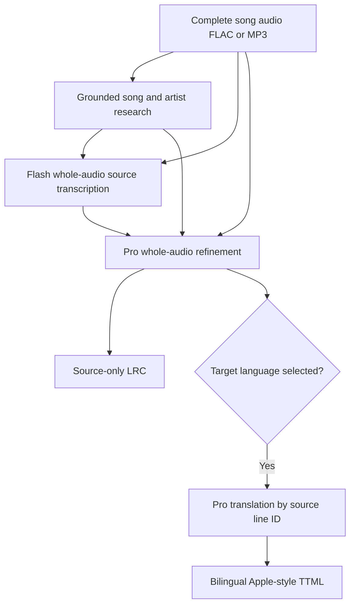
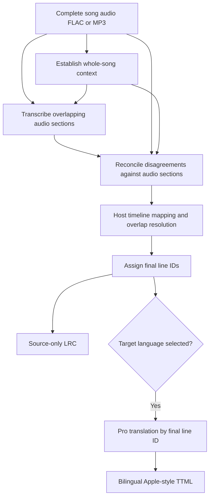

# Lyrics generator

This context defines the architecture, schemas, authority rules, output formats, and run lifecycle for the lyrics generator.

## Purpose

The project recovers synchronized lyrics from complete song audio files through audio-only processing.
Audio-only recovery serves as the core foundation because published lyrics do not exist for all recordings.
The pipeline supports standard audio formats, including FLAC and MP3.
The target design permits trusted online lyric sources as optional secondary evidence.
The project does not require online lyric retrieval to run.
Existing local lyric files serve only as external evaluation benchmarks.
Generation stages never read local lyric files or incorporate them into prompts.
The pipeline creates a standard source-only line-timed LRC file.
When you select a target language tag, it translates the source lyrics and creates a bilingual Apple-style TTML file for Gramophone.

## Non-goals

The project explicitly excludes these features:
- Video chunking or video stream processing.
- Word-level karaoke timing spans.
- Performer assignment or duet markup.
- Musical part divisions such as verse or chorus tags.
- Transliteration or romanization tracks.

## Architecture and implementation status

The project maintains an explicit distinction between the implemented production pipeline and the target section-based design.
The production CLI uses the implemented whole-song pipeline.
The section-based architecture represents the intended migration target under active design.

### Implemented production pipeline

The song audio remains authoritative for transcription and refinement.
Research provides verified identity, language, and metadata context through Google Search grounding.
Flash establishes the initial line structure and timestamps across the complete audio file.
Pro evaluates the complete audio and returns only sparse text and timestamp corrections on existing line IDs.
The host applies those corrections deterministically and preserves unchanged lines and fields.
Pro cannot add, delete, merge, split, or reorder lines in this implemented stage.

### Target section-based architecture design

The target design tests the hypothesis that transcribing complete audio through localized overlapping sections improves lyric recovery on complex vocal passages.
The target pipeline executes these stages:
1. Complete song audio: Ingests the full-length audio file without prior manual segmentation.
2. Whole-song context: Gathers global linguistic patterns, song metadata, and optional secondary web evidence when available online.
3. Overlapping audio sections: Transcribes localized audio intervals that overlap across boundaries to preserve transitional vocal phrasing.
4. Section reconciliation: Evaluates candidate disagreements directly against the corresponding audio sections.
5. Timeline mapping and overlap resolution: Maps local section timestamps back to the original song timeline and resolves boundary overlaps deterministically in host code.
6. Final line ID assignment: Assigns canonical sequential line IDs only after reconciliation finishes, preventing premature structural lock-in.
7. Validation and export: Validates line timing invariants and exports standard source-only LRC.
8. Translation and bilingual export: Translates reconciled lines by final line ID and exports bilingual Apple-style TTML when you specify a target language tag.

### Component roles and operational boundaries

In the target design, each system layer operates within strict boundaries:

- Gemini Pro:
  Pro supplies global linguistic knowledge, stylistic context, and plausible untimed candidate wording for ambiguous passages.
  Pro does not perform an unrestricted final rewrite of transcribed lyrics.
  Unrestricted Pro rewrites can replace supported wording with unsupported alternatives.

- Gemini Flash:
  Flash verifies actual audio locally within each section.
  Flash owns final phrase segmentation and line timing against the audio.
  Flash does not lock its initial line structure before reconciliation completes.

- Host:
  The host orchestrates the run lifecycle and enforces data integrity.
  The host maps local section timestamps back to the song timeline deterministically.
  The host handles overlap resolution across adjacent section boundaries.
  The host protects accepted content outside reconsidered spans.
  The host assigns final line IDs only after reconciliation succeeds.

### Unresolved design choices

The target section-based architecture leaves several operational parameters open for empirical testing:
- Section durations and boundary overlap dimensions.
- Concurrency levels and worker execution models.
- New CLI options and configuration settings.
- Intermediate section payload schemas.
- Lossless audio transport in production.

The repository avoids speculative implementations of these choices until experiments justify them.
Both the implemented production pipeline and the target section-based design execute every invocation from scratch.
Neither architecture permits cross-run caching, stage-result reuse, or checkpoint resume mechanisms.

### Benchmark findings and design rationale

An empirical evaluation tested eight pipeline architectures across 16 runs on a bilingual rap track.
Each architecture executed two fresh repetitions without cross-run caching.
The evaluation revealed these behavioral findings:

- Audio-only recognition exhibited substantial wording discrepancies across all architectures.
- The two-run sample did not demonstrate a clear, robust winner between Flash-first and Pro-first audio-only pipelines.
- Generating untimed Pro text first can anchor errors in downstream timing stages.
- Restricting Flash to pre-locked candidate text does not ensure correctness.
- Alignment responses that report zero unmatched phrases can still mask significant wording errors.
- An extra unrestricted Pro rewrite pass after transcription sometimes regresses correct phrases.
- Verified source retrieval paired with Flash preserved the supplied wording and produced closer reference-relative onset timing than Pro on the test recording.
- External lyric retrieval cannot serve as the foundational architecture because published lyrics do not exist for every song.
- The evaluation reference lacked end timestamps, leaving line endings, gap cues, and additional vocals unverified.
- Two repetitions on a single track illustrate local trade-offs and do not support universal quality claims.

## Repository layout

| Path | Responsibility |
| --- | --- |
| `gemini_lyrics.py` | CLI argument parsing, dotenv loading, validation dispatch, and error reporting. |
| `modules/core.py` | Schemas, timing validation, LRC serialization, and TTML serialization. |
| `modules/io.py` | Atomic diagnostic writes and no-replace final publication. |
| `modules/media.py` | Audio duration probing, stream probing, and complete-audio normalization. |
| `modules/gemini.py` | Gemini client configuration and request adapters. |
| `modules/pipeline.py` | Stage orchestration, isolated working files, and run lifecycle. |

Keep the five modules in an acyclic dependency graph:

- `core.py` and `io.py` have no project-internal imports.
- `media.py` has no project-internal imports.
- `gemini.py` depends on `core`, `io`, and `media`.
- `pipeline.py` orchestrates media and Gemini and owns the run lifecycle.
- `gemini_lyrics.py` stays CLI-only.

## Audio normalization

Media operations use FFmpeg and FFprobe.
The pipeline probes container duration and audio streams from the input file.
The source must contain at least one audio stream.
Production normalization extracts the first audio stream to mono Ogg Opus at 48000 Hz and 64 kbps.
The normalized file is validated against codec, channel count, sample rate, and duration tolerance.
Normalization runs atomically through a temporary file.
Experimental runners evaluate lossless formats such as mono 16-bit FLAC, but lossless normalization is not yet part of production `media.py`.

## Models and requests

The default transcription model is `gemini-3.8-flash`.
The default research, refinement, and translation model is `gemini-3.1-pro-preview`.
All requests use temperature 1.0 to avoid low-temperature looping.
All requests stream responses and set `thinking_level="HIGH"` with thought summaries enabled.
The CLI reports stage and model names, received SDK chunk counts, separate answer and thought character counts, and elapsed time without exposing response text.
Closing summaries include answer and thought token counts when reported by the API.
Progress updates follow received chunks and do not generate idle heartbeats.
Every direct Gemini request disables automatic function calling explicitly with `build_content_config()`.
The SDK retry configuration handles transient transport and service errors.
Every invocation runs selected stages from scratch without reusing cached results.

Research uses Google Search grounding and plain-text output.
The host rejects research that returns neither search queries nor grounded sources.
Transcription, refinement, and translation use structured Pydantic response schemas.
Request schemas omit `additionalProperties` for endpoint compatibility.
Local response validation still rejects extra fields.
Audio data passes inline as bytes within the request payload.

## Schemas

`LyricLine` contains `id`, `start`, `end`, and `text`.
In the implemented pipeline, line IDs are sequential strings starting from `L1` in chronological order.
In the target design, final line IDs are assigned only after section reconciliation finishes.
Timestamps use `HH:MM:SS.mmm` format.
`LyricsResponse` contains the complete `lines` list.

`LyricCorrection` contains an existing `id` and optional `text`, `start`, and `end` fields.
`RefinementResponse` contains a `changes` list with only lines needing correction.
Omitted or null fields preserve the draft value.
Unknown IDs and duplicate corrections fail validation.
The corrected script must satisfy the same timing and text validation as the draft.

`TranslationLine` contains a source `id` and translated `text`.
`TranslationResponse` contains the complete `translations` list.
Translations must match every refined source ID exactly once and in identical order.
Translations do not contain timing properties.

`GroundedSource` contains `title` and `url`.
`SongContext` stores the grounded summary, search queries, and grounded sources.

## Source lyric authority

Source lyrics preserve every language actually sung.
They preserve audible repetitions, ad-libs, interjections, and incomplete phrases.
They contain no generated translation or romanization.
The pipeline never uses existing lyric files as prompt context.

Every lyric line must satisfy these invariants:
- The start time must be finite and nonnegative.
- The end time must be greater than the start time.
- The interval must remain positive after millisecond rounding.
- The end time must not exceed the probed song duration.
- Lines must remain ordered chronologically by start time.
- Line text must not be blank.

## LRC output

The pipeline emits standard line-timed LRC files.
Timestamps use `[mm:ss.xx]` format with deterministic half-up centisecond rounding.
Hours roll into minutes.
The LRC file contains source-language lyrics only.
An empty timestamped cue marks a gap only after all preceding overlapping lines end and before the next line begins.

## Bilingual TTML output

When a target language tag is provided, the pipeline emits bilingual TTML.
The file targets Gramophone on Android for simultaneous bilingual rendering.
The root element uses the W3C TTML namespace `http://www.w3.org/ns/ttml`.
Attributes `itunes:timing="Line"` and line keys `itunes:key` use `http://music.apple.com/lyric-ttml-internal`.
Gramophone requires this internal Apple namespace for line timing and key indexing.

The `<head><metadata>` section contains `<iTunesMetadata xmlns="http://music.apple.com/lyric-ttml-internal">`.
This section holds `<translations>` with a `<translation type="subtitle" xml:lang="...">` container.
Each translated line is an un-timed `<text for="...">` tag linking to a source line key.
The timed body contains source lyrics in `
` elements.
Gramophone renders the source line and pairs the matching translation beneath it.

## Safe publication

Outputs write as sidecars matching the audio stem.
Default execution places sidecars in the audio file directory.
The `--output-dir` option selects an alternative destination directory.

The pipeline prevents destructive file replacement.
Validation checks all planned outputs before media conversion or API calls.
If an output file already exists, execution halts immediately with an error.
This behavior protects provided benchmark files, such as `3RACHA (Bang Chan, Changbin, HAN).lrc`.
Generating outputs for benchmark audio requires an explicit `--output-dir`.

Final output files use atomic no-replace publication via hard links.
Diagnostic files use atomic replacement via temporary files and filesystem synchronization.

## Working files

Both the implemented production pipeline and the target section design run all stages from scratch.
Neither architecture supports caching stage results or resuming incomplete runs across invocations.
The pipeline holds context, draft lyrics, refined lyrics, and translations in memory.
It creates a unique directory under `.lyrics-generator-work/` for normalized audio and failure diagnostics.
Independent runs use separate directories and need no shared work lock.
Successful runs remove their work directory.
Failed runs retain their work directory and print its location for inspection.
Failed structured streams retain partial answer text and timing/count diagnostics, including on token-budget exhaustion.
Later invocations do not reuse those files.

## Glossary

**Audio-only lyric recovery**:
The generation of synchronized lyrics directly from song audio without requiring external lyric transcripts.

**Benchmark lyric file**:
A reference lyric file preserved for external evaluation, never supplied to generation models.

**Complete song audio**:
An unsegmented full-track audio file, such as FLAC or MP3.

**Draft transcription**:
The initial complete source-language timed lyric proposal generated by Gemini Flash.

**Final line ID (target design)**:
A sequential identifier, such as `L1`, assigned to a reconciled lyric line only after timeline mapping and overlap resolution finish.

**Grounded song context**:
Verified song, artist, and language metadata obtained with Google Search grounding.

**Overlapping audio section**:
A bounded temporal segment of normalized audio that shares boundary intervals with adjacent segments to preserve transitional vocal phrases.

**Refined source lyrics**:
The Flash draft with Pro audio-supported text and timing corrections applied.

**Secondary lyric evidence**:
Optional lyric text retrieved from trusted online sources to inform context, never required for pipeline execution.

**Section reconciliation**:
The resolution of lyric text and timing disagreements within an audio section by combining Pro linguistic guidance with Flash local audio verification.

**Sidecar file**:
An output file sharing the source audio directory and stem name with an `.lrc` or `.ttml` extension.

**Source line ID**:
A sequential identifier such as `L1` that links a source line to its translation.
