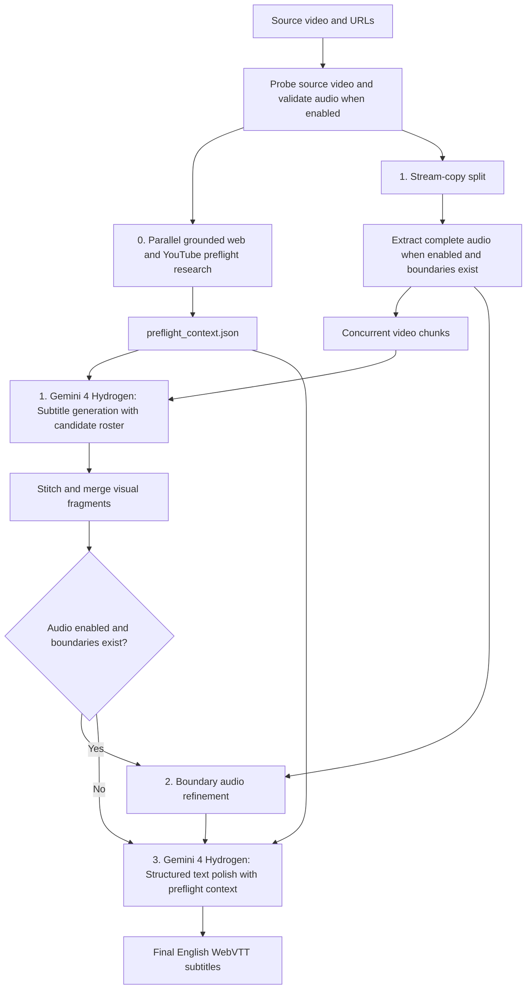

# Gemini subtitle generator

A Python CLI that uses the Google Gemini API to generate English WebVTT subtitles from video.
It uses a four-pass pipeline:

0. Researches participant identities and topic terminology with grounded web search and optional YouTube video analysis.
1. Generates chunk subtitles concurrently using candidate speaker identities.
2. Repairs chunk boundaries against the complete extracted audio track.
3. Refines the complete script with structured proofreading and the preflight context.

## Pipeline overview



Preflight runs concurrently with splitting and subsequent audio extraction.
Chunk generation waits for both media preparation and the preflight context.
The work-directory lock stays held until all preflight work settles, including on failure.

## Features

- **Audio-first generation:** Create English WebVTT subtitles with accurate speech timing and meaningful on-screen text.
- **Concurrent chunk processing:** Process 60-second stream-copy chunks in parallel across multiple Gemini API workers.
- **Boundary audio refinement:** Listen to the complete extracted audio track and repair dialogue faults near chunk boundaries without altering visual text.
- **Grounded preflight and text polish:** Research participant names and proper nouns with Google Search, optional URL Context, and direct YouTube video analysis.
  Speaker attribution relies on verified evidence rather than appearance guesses.
- **Structured validation:** Validate model responses with Pydantic schemas to catch malformed timestamps, duplicate IDs, and broken cue structure.
- **Resumable failures:** Preserve temporary work directories on failure so retries reuse valid chunks, extracted audio, and refinement caches.
  Clean up temporary work files automatically on success.
- **Atomic outputs:** Write chunk JSON, extracted audio, and final WebVTT files via temporary siblings before replacing the target file.

## Prerequisites

- Python 3.14 or newer (managed automatically by `uv`).
- [uv](https://github.com/astral-sh/uv) - Python package installer and resolver.
- [FFmpeg](https://ffmpeg.org/) - `ffmpeg` and `ffprobe` in your system `PATH`.
  - **Headless Linux / WSL installation:** Install precompiled GPL static binaries without X11 dependencies into `~/.local/bin`:
    ```bash
    ./scripts/ffmpeg.sh
    ```
    Add `~/.local/bin` to your `PATH` by adding `export PATH="$HOME/.local/bin:$PATH"` to your shell profile.
- [yt-dlp](https://github.com/yt-dlp/yt-dlp) - Optional tool run via `uvx` by `./scripts/yt-dl.sh`.

## Installation

1. Clone this repository.
2. Install dependencies with `uv`:
   ```bash
   uv sync
   ```
3. Create a `.env` file in the root directory (see `.env.example`) and add your Gemini API credentials:
   ```env
   GEMINI_API_KEY=your_api_key_here

   # Optional: set a custom base URL or override default models
   # GEMINI_API_BASE=https://main.your-proxy-domain.com/google/v1beta
   # GEMINI_MODEL=gemini-4-hydrogen
   # GEMINI_AUDIO_REFINE_MODEL=gemini-4-hydrogen
   # GEMINI_REFINE_MODEL=gemini-4-hydrogen
   ```

## Usage

Run commands from the repository root with `uv run`.

### Generate subtitles

Generate English subtitles from a local video:
```bash
uv run python gemini_subs.py "your_video.webm" --output "generated_subtitles.vtt"
```

Supply context URLs for participant identity research and terminology grounding:
```bash
uv run python gemini_subs.py "your_video.webm" \
  --context-url "https://youtube.com/watch?v=..." \
  --output "generated_subtitles.vtt"
```

Skip boundary audio refinement (for example, on silent videos):
```bash
uv run python gemini_subs.py "your_video.webm" --disable-audio-refine
```

Skip global text refinement:
```bash
uv run python gemini_subs.py "your_video.webm" --disable-text-refine
```

Refine an existing WebVTT file without video processing:
```bash
uv run python gemini_subs.py "generated_subtitles.vtt" --refine-only -o "polished_subtitles.vtt"
```

### Helper scripts

Download a YouTube video as VP9 with Opus or Vorbis audio in WebM:
```bash
./scripts/yt-dl.sh "https://youtube.com/watch?v=..."
```

Generate `<video>.vtt` with optional interactive context URL prompting:
```bash
./scripts/subtitle.sh "your_video.webm"
```

When you omit the context URL argument, `./scripts/subtitle.sh` prompts once only if standard input is a terminal.
Press Enter with a blank answer to skip grounding URLs.

Supply a context URL noninteractively as the second argument, or redirect standard input to suppress prompting:
```bash
./scripts/subtitle.sh "your_video.webm" "https://youtube.com/watch?v=..."
./scripts/subtitle.sh "your_video.webm" </dev/null
```

### Benchmarking

Compare model combinations across full video runs:
```bash
./scripts/benchmark.py "your_video.webm" --case gemini-4-hydrogen:gemini-4-hydrogen:gemini-4-hydrogen
```

Compare chunk-only output against a reference WebVTT file:
```bash
./scripts/benchmark.py "your_video.webm" --model gemini-4-hydrogen --reference-vtt "reference.vtt"
```

The benchmark writes generated VTT artifacts and `benchmark-results.json` to the output directory (`benchmark_results/` by default).
It runs Pass 0 preflight once per unique generation model at `high` thinking and caches the result in that model's generation work directory.
Chunk generation and text refinement reuse the preflight context for each case's generation model.

### How the pipeline works

By default, all passes use `gemini-4-hydrogen`.
Preflight research and refinement passes run at `high` thinking, and chunk generation defaults to `high`.

1. **Preflight (Pass 0):** Runs grounded Google Search (plus URL Context for non-YouTube URLs) and, when YouTube URLs are supplied, a concurrent direct YouTube video analysis pass.
   Preflight fails before chunk generation (or before publication in `--refine-only` mode) when Search grounding is missing, a context URL fails retrieval, or a YouTube video is unavailable.
   There is no ungrounded fallback, and any existing output file stays intact.
2. **Chunk generation (Pass 1):** Splits the video at keyframes into 60-second stream-copy chunks and subtitles each chunk concurrently using candidate speaker identities from Pass 0.
3. **Boundary audio refinement (Pass 2):** Extracts the complete mono Opus audio track and sends it with the stitched script to repair dialogue faults within 10 seconds of chunk boundaries.
   The host discards edits outside repair regions and rejects patches that alter bracketed visual text.
   Single-chunk runs skip audio extraction and Pass 2 because they have no repair boundaries.
4. **Global text refinement (Pass 3):** Sends the script and preflight context to fix speaker label consistency, proper nouns, typos, and objective errors without changing timestamps.

Generation publishes one final artifact based on the refinement toggles:

| Audio refinement | Text refinement | Published input |
| --- | --- | --- |
| Enabled (default) | Enabled (default) | Text-refined `audio_refined.vtt` |
| Enabled | `--disable-text-refine` | `audio_refined.vtt` |
| `--disable-audio-refine` | Enabled | Text-refined `stitched.vtt` |
| `--disable-audio-refine` | `--disable-text-refine` | `stitched.vtt` |

Single-chunk runs follow the audio-disabled rows regardless of `--disable-audio-refine`.

### CLI options

- `--output`, `-o`: Output WebVTT file path (default: `output_subtitles.vtt`).
- `--disable-audio-refine`: Disable the boundary audio refinement pass after generation.
- `--disable-text-refine`: Disable the global text refinement pass after generation.
- `--refine-only`: Skip video processing and run global text refinement on an input WebVTT file.
- `--chunk-dur`: Video chunk duration in seconds (default: `60`).
- `--workers`: Maximum concurrent API workers (default: `7`).
- `--thinking-level`: Gemini thinking level for chunk video requests: `low`, `medium`, `high`, or `xhigh` (default: `high`).
  `xhigh` applies to `gemini-4-hydrogen`.
  Audio and text refinement passes always use `high`.
- `--api-key`: Override `GEMINI_API_KEY` from `.env` or the environment.
- `--base-url`: Override `GEMINI_API_BASE` for a custom Gemini-compatible proxy.
- `--model`: Override `GEMINI_MODEL` for chunk video generation (default: `gemini-4-hydrogen`).
- `--audio-refine-model`: Override `GEMINI_AUDIO_REFINE_MODEL` for boundary audio refinement (default: `gemini-4-hydrogen`).
- `--refine-model`: Override `GEMINI_REFINE_MODEL` for global text refinement (default: `gemini-4-hydrogen`).
- `--context-url`: Absolute HTTP(S) URL used as grounding context for preflight research, chunk generation, and global text refinement.
  Repeat the option to supply several URLs.
  Public YouTube watch or share URLs (`youtube.com`, `www.youtube.com`, or `m.youtube.com` with `/watch` and a nonempty `v` query, or `youtu.be` with one path segment) run in the direct YouTube analysis pass.
  Other URLs use the URL Context tool.

## Notes

- Stream-copy splitting (`-c copy`) cuts at keyframes for VP9 (`.webm`), H.264 (`.mp4`), and HEVC/H.265 (`.mp4`) inputs.
  Other codecs such as AV1 fail during probing.
- Boundary audio refinement requires an audio stream.
  Generation fails before splitting when the source has no audio and audio refinement is enabled.
  Pass `--disable-audio-refine` for silent video.
- Keep inline chunk video and extracted audio payloads below 50 MiB.
  Base64 overhead counts toward the 100 MB total inline request limit.
  Reduce `--chunk-dur` if chunk uploads fail.
- Create the output parent directory before running either CLI mode.
  The CLI writes errors to standard error, and failed runs keep the work directory under `temp_video_chunks/` for retry.
- Generated `.vtt` files are ignored by Git by default.
  Move or rename files if you want to track specific subtitle outputs.

## Development

Production modules live under `modules/`, orchestrated by `modules/pipeline.py` and dispatched by `gemini_subs.py`.
`CONTEXT.md` is the authoritative architectural and domain specification.
`AGENTS.md` defines agent workflow and coding instructions, and `tests/README.md` documents the test contract matrix.
Tests under `tests/` cover end-to-end pipeline flows and capability contracts (`tests/test_e2e_pipeline.py`, `tests/test_cli.py`, `tests/test_media_io.py`, `tests/test_audio_patch.py`, and `tests/test_text_contracts.py`).

Run code quality checks and tests:

```bash
# Lint, format, and static checks
shellcheck scripts/subtitle.sh scripts/yt-dl.sh scripts/ffmpeg.sh
uv run ruff check .
uv run ruff format --check .
uv run python -m compileall -q .

# Targeted capability tests or complete suite
uv run pytest tests/test_e2e_pipeline.py
uv run pytest tests/test_cli.py
uv run pytest tests/test_media_io.py
uv run pytest tests/test_audio_patch.py
uv run pytest tests/test_text_contracts.py
uv run pytest

# CLI entry points
uv run python gemini_subs.py --help
./scripts/benchmark.py --help
```
